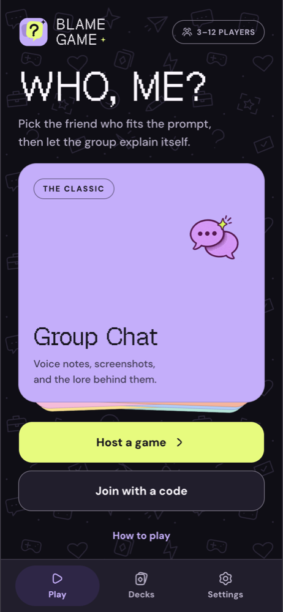
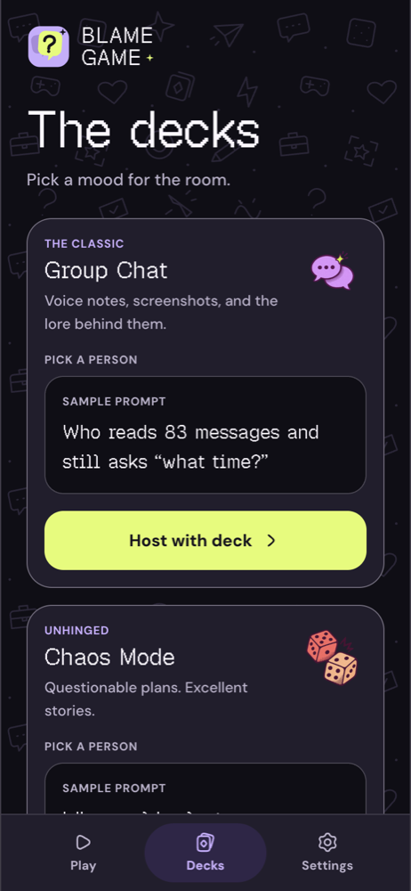

# Blame Game

a party game for 3–12 friends. pick a deck, vote for who fits the prompt, and let the host reveal where everyone landed. Spotlight is for written answers.

 

## get the app

[Download the Android APK](https://github.com/romeirofernandes/blamegame/releases/download/v1.0.1/blame-game.apk) for Android 7 or newer on a 64-bit device. the [release notes](https://github.com/romeirofernandes/blamegame/releases/tag/v1.0.1) have the checksum and Google sign-in setup.

play in your browser at [blame-game.theromeirofernandes.workers.dev](https://blame-game.theromeirofernandes.workers.dev). host a game and send the room code or invite link to your friends.

## run locally

you'll need [Bun](https://bun.sh/) and a [Firebase project](https://console.firebase.google.com/) with Email/Password sign-in enabled. put the Android Firebase config at `google-services.json` in the repo root, or copy `.env.example` to `.env.local` and fill in the public Firebase web settings.

```sh
bun install --frozen-lockfile
bun install --cwd worker --frozen-lockfile
bun run build:web
bun run server
```

open [localhost:3000](http://localhost:3000). use three separate browser profiles and accounts if you're trying a room on one computer.

## deploy the room server

the [Cloudflare Worker](https://developers.cloudflare.com/workers/) serves the web app and handles multiplayer through WebSockets. Wrangler creates the SQLite-backed Durable Object for rooms from the checked-in configuration.

1. match `FIREBASE_PROJECT_ID` in [worker/wrangler.jsonc](worker/wrangler.jsonc) to the Firebase project used by the app.
2. from the repo root, run `bun run --cwd worker wrangler login` if you aren't already logged in, then `bun run deploy:worker`.
3. open `<worker-url>/health` and check that it says `ok`. if you're using Google sign-in on the web, enable Google in Firebase Authentication and add the deployed hostname under **Settings → Authorized domains**.

for a standalone APK, set `EXPO_PUBLIC_SERVER_URL` to the Worker’s HTTPS origin at build time. Android Google sign-in also needs the APK signing certificate’s SHA-1 registered on the Firebase Android app (`com.blame.game`).

```sh
bunx eas-cli env:set --name EXPO_PUBLIC_SERVER_URL --value https://your-worker.workers.dev --environment preview --visibility plaintext
bunx eas-cli build --platform android --profile preview
```

for an EAS cloud build, supply `GOOGLE_SERVICES_JSON` as a file environment variable in the build environment.

## checks

```sh
bun run check
bun test
```
